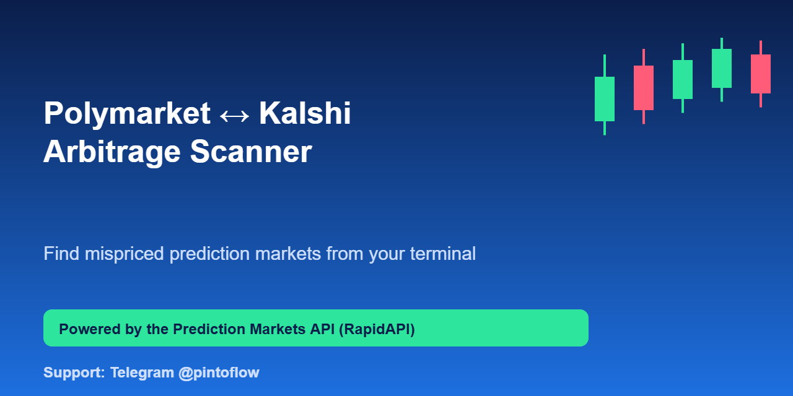
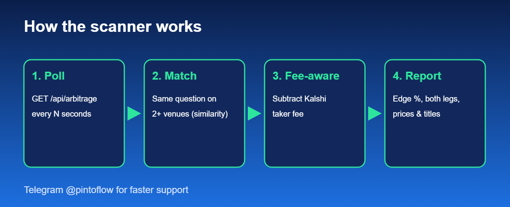

<p align="center"></p>

# Polymarket ↔ Kalshi Arbitrage Scanner

A small Python CLI that scans **Polymarket, Kalshi and Manifold** for the same question priced differently, and for **dutch-book** mispricings inside multi-candidate events. Built on the [Prediction Markets API](https://rapidapi.com/belchiorarkad-FqvHs2EDOtP/api/prediction-markets).

> ⚡ Questions or want a feature? Telegram **[@pintoflow](https://t.me/pintoflow)** answers fastest.



## Why this exists

Prediction markets are fragmented. The same event ("Fed cuts rates in October", "BTC above 100k") often trades at different prices on different venues. Buying **Yes** on one and **No** on the other costs less than $1 when the gap is big enough, and one side always pays $1. This tool automates the search so you do not eyeball three websites.

Two kinds of mispricing are covered:

| Mode | Endpoint | Idea |
|---|---|---|
| Cross-venue | `/api/arbitrage` | Yes on venue A + No on venue B costs < $1 |
| Dutch book | `/api/arbitrage/events` | In a mutually-exclusive event the Yes prices of every candidate should sum to $1; if they sum to less, buy the whole field |

## Quick start

```bash
git clone https://github.com/BelNaruto/polymarket-kalshi-arbitrage-scanner
cd polymarket-kalshi-arbitrage-scanner
pip install -r requirements.txt

# 1. get a key: https://rapidapi.com/belchiorarkad-FqvHs2EDOtP/api/prediction-markets (a free plan exists)
export RAPIDAPI_KEY=your-key
export RAPIDAPI_HOST=host-from-the-endpoints-tab

python scanner.py -q bitcoin --min-edge 0.02 --fee-aware   # cross-venue
python scanner.py --events -q "prime minister"             # dutch book
python scanner.py -q election --watch 60                   # repeat every 60s
```

## Options

| Flag | Meaning |
|---|---|
| `-q` | topic filter (strongly recommended: faster and more precise) |
| `--min-edge` | minimum edge, `0.02` = 2% |
| `--fee-aware` | subtract Kalshi's taker fee `ceil(0.07 * p * (1-p))` from each Kalshi leg |
| `--events` | run the same-venue dutch-book scan |
| `--watch N` | rerun every N seconds (min 10) |

## Reading the output

```
Scanned {'polymarket': 100, 'kalshi': 150, 'manifold': 75}  |  1 opportunities (edge >= 2.0%)
   4.50%  sim=1.00  cost=0.955  Yes@polymarket 0.115 + No@kalshi 0.840
          Will Naftali Bennett be the next Prime Minister of Israel?
```

- **edge** is the guaranteed profit per $1 *before slippage*. Always confirm live depth with `/api/markets/{venue}/{id}/orderbook`.
- **sim** is how confident the title match is. Below about 0.7, check by hand that both venues really mean the same question and resolution rules.

## Ideas to extend

- Push results to Telegram/Discord (see [prediction-market-telegram-bot](https://github.com/BelNaruto/prediction-market-telegram-bot))
- Log opportunities to SQLite and study how long gaps last
- Add `/orderbook` checks to estimate fillable size

## Disclaimer

Informational only, not financial advice. Fees, slippage, resolution-rule differences and thin order books can turn a paper edge into a loss. Not affiliated with Polymarket, Kalshi or Manifold.

---
⚡ **Need help fast? Telegram [@pintoflow](https://t.me/pintoflow)** · API: [https://rapidapi.com/belchiorarkad-FqvHs2EDOtP/api/prediction-markets](https://rapidapi.com/belchiorarkad-FqvHs2EDOtP/api/prediction-markets) · MIT license
